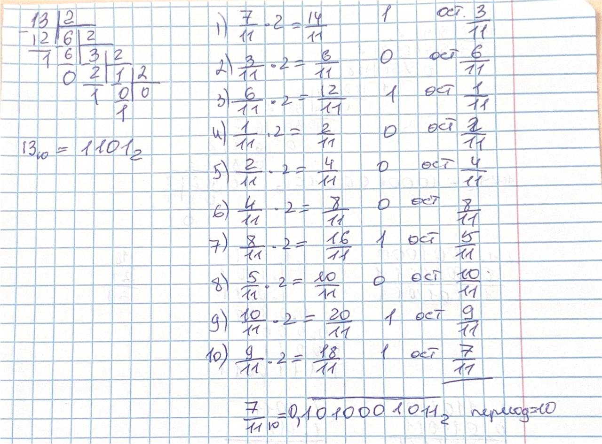
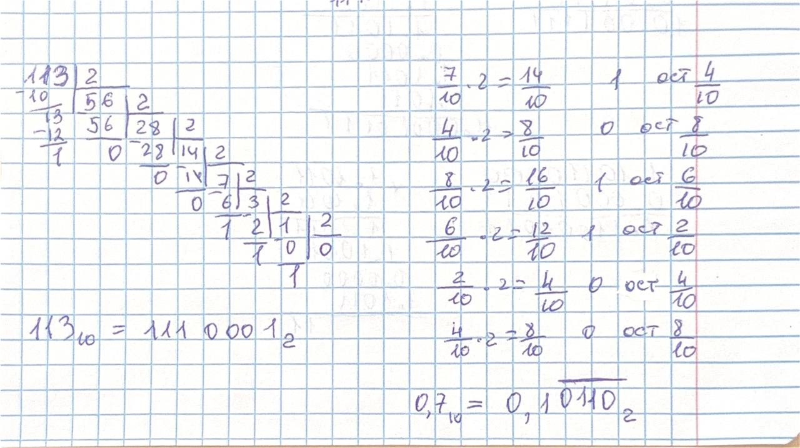
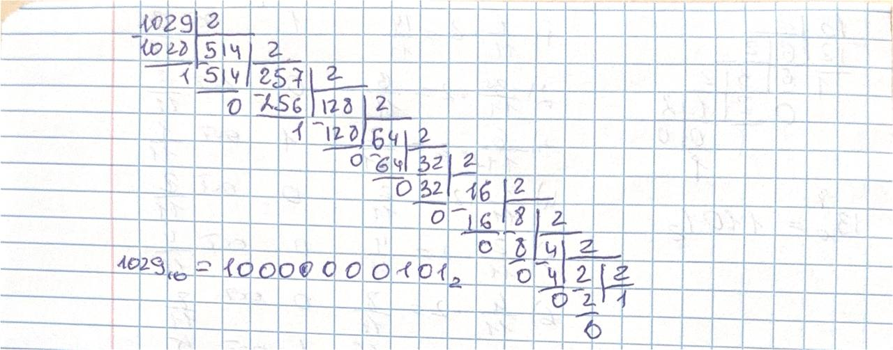
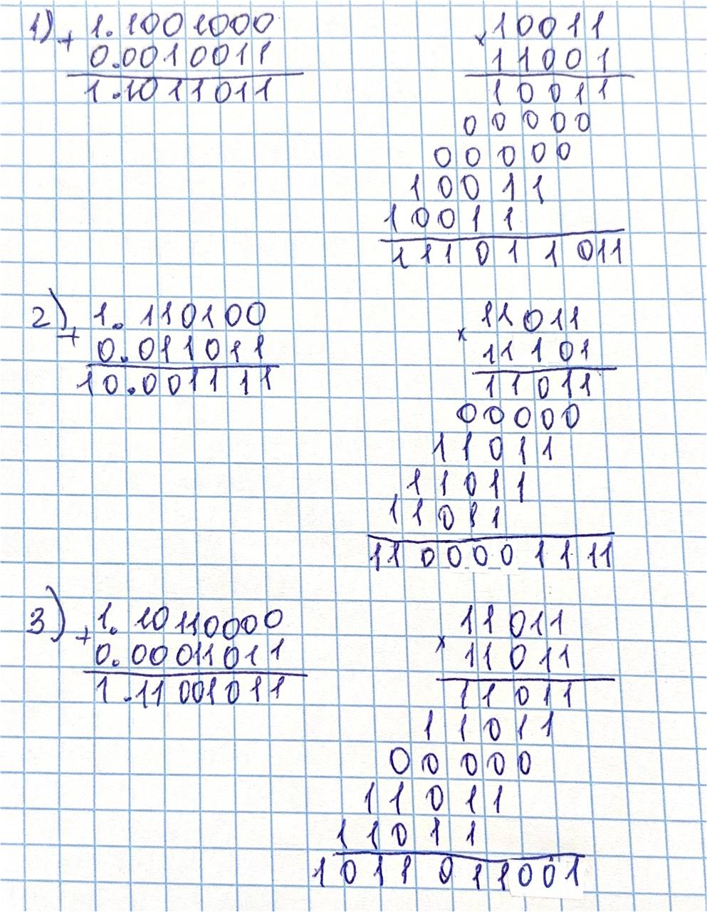

# Языки программирования
## Лабораторная работа 5

### Задание 1 **(2)**
*Переведите в двоичную запись два произвольных рациональных числа (числа вида* $\frac{p}{q}$).
*У одного из чисел знаменатель должен быть степенью двойки (32), а у другого --- некоторым числом
от 9 до 12.*
*Запись второго числа будет содержать период. Его надо найти. При решении задачи нельзя 
использовать вычислительную технику. Процесс решения должен быть представлен в отчете.*

число 1 пусть будет 13/32

знаменатель 32=2^5, поэтому дробь будет конечная в 2сс

переводим число 13 в 2сс, получается 1101 (см. фото)

делим на 2^5, то есть сдвигаем запятую на 5 позиций влево, получается 0,01101 в 2сс

Ответ: 13/32 в 10 сс это 0,01101 в 2 сс

число 2 пусть будет 7/11
	
переводим в 2сс с помощью умножения на 2 (см. фото) 

на шаге 10 остаток снова становится равен исходной дроби, занчит период содержит 10 цифр

Ответ: 7/11 в 10сс это 0,1010001011 в 2сс, период 10 




### Задание 2 **(3)**
*Переведите в двоичную запись и найдите машинное представление в типе* **double**
*для произвольного вещественного числа большего, чем 100 с одним знаком после точки, например
для* $113.7$. *Цифра после точки не должна быть нулем иля пятеркой.*
*При решении задачи нельзя 
использовать вычислительную технику. Процесс решения должен быть представлен в отчете.*

Число 113.7

Сначала переводим в 2сс целую часть (см. фото)
Далее переводим дробную часть с помошью умножения на 2 (см.фото). Остаток 4/10 повторился на шаге 5 и 2, занчит период начинается с шага два, период "0110"
Теперь нормализуем. 113.7 = 1110001,1011001100110.... в 2сс. Нормализуем сдвигом запятой на 6 позиций влево: 113.7 = 1,1100011011... в 2сс *2^6 это нужно чтобы хранить только значащие цифры и отдельно-показатель степени. порядок = 6, мантисса = то, что после запятой.
	
Представление в типе double. Число в памяти запимает ровно 64 бита, разбитых на 3 поля: знак, экспонента и мантисса
Вычисляем хранимую экспоненту: реальный порядок=6, смещение=1023, хранимая экспонента=6+1023=1029. Переводим 1029 в 2сс, получается 10000000101
Берем первые 52 бита после запятой из нормализованной запси, получается мантисса = 1100011011001100110011001100110011001100110011001100
Собираем 64 бита: 0 10000000101 1100011011001100110011001100110011001100110011001100
Переводим в hex, то как хранится в компьютере, для этого группируем по 4 бита:

Знак + экспонента:
0 1000 0000 101 - дополняем до 12 бит: 0100 0000 0101 = 0x405

Мантисса:
1100 0110 1100 1100 1100 1100 1100 1100 1100 1100 1100 1100 1100 = C6CCCCCCCCCC

Получается: 0x405C6CCCCCCCCCCC
С учётом округления последнего бита (так как 53-й бит мантиссы = 1, происходит округление вверх): 0x405C6CCCCCCCCCCD 






### Задание 3 **(3)**
*Найдите сумму и произведение для записанных далее пар чисел. Числа заданы в двоичной записи 
в экспоненциальном виде. Ответ необходимо записать в нормализованннои экспоненциальном виде.*

* 1.0011e18 и $1.1001e21;
* 1.1011e-25 и, $1.1101e-23;
* 1.1011e-3 и $1.1011e1.
  
*При решении задачи нельзя 
использовать вычислительную технику. Процесс решения должен быть представлен в отчете.*

Первая пара: 1.0011 * 2^18 1.1001 * 2^21
	
	Для вычисления суммы мы сначала переводим к большему порядку(21): 1,0011 * 2^18 = 0.0010011 * 2^21
	Сумма: 1.1011011 * 2^21 (вычисления на фото)
	Для вычисления произвдение сначала считаем порядок = 18+21=39
	Произведение: 1.11011011  * 2^39

Вторая пара: 1.1011 * 2^-25 1.1101 * 2^-23

	Для вычисления суммы приводим к порядку -23: 1,1011 * 2^-25 = 0,011011 * 2^-23
	Сумма получилась = 10,001111. получается 1,0001111 * 2^1 (нормализовали).
	Вычтсляем порядок -23+1=-22. Итог: сумма = 1,0001111 * 2^-22
	Произведение получается: 11,00001111 * 2^1.
	Вычисляем порядок -25-23+1=-47
	Итого произведение = 1,100001111 * 2^-47

Третья пара: 1,1011 * 2^-3 1.1011 * 2^1

	Приводим к порядку 1: 1,1011 * 2^-3 = 0,00011011 * 2^1
	Сумма = 1,11001011 * 2^1
	Произвдение получается 10,11011001, нормализуем, получается, 1,011011001 * 2^1
	Порядок  -3+1+1=-1
	Итого: 1,011011001 * 2^-1 




### Задание 4 **(2)**

*Рассмотрим следующий пример в IDLE Python*
```
>>> x = 99.99
>>> int(x/10+0.001)
9
```
*Результат должен был быть равен 10, однако оказался другим. Почему так произошло?
Как исправить программу, чтобы она корректно переводила вещественные числа в целые?*

Число 99.99 в двоичной системе — бесконечная периодическая дробь, оно не может быть представлено в двоичной системе с конечным числом бит.
Double хранит только 52 бита мантиссы, поэтому 99.99 храниться в памяти как число чуть меньшее 99.99. 

x/10 + 0.001 даёт число чуть меньше 10, потому что: x в памяти чуть меньше 99.99, деление на 10 сохраняет эту недостаточность, прибавление 0.001 (которое тоже хранится неточно) не компенсирует её полностью.

int() отбрасывает дробную часть, не округляя. Поэтому int(9.999999....) = 9.

Исправленный вариант программы:
```
x=99.99
res=round(x/10 + 0.001)
print(res)
```

### Задание 5. **(2)**

*Рассмотрите следующую программу. Объясните результаты ее работы. В частности,
как величина* $y$ *повлияла на ответ?*
```
x = 1/3
y = 1
for i in range(20):
    print((x+y)-y)
    y*=10
```
*В отчете требуется привести вычисления для оценки погрешности.*

Если бы арифметика была точной, (x+y)-y = x = 0.3333… всегда.
Из-за конечной точности double (53 бита мантиссы, примерно 16 десятичных цифр) при сложении x+y, y>x, младшие биты
х выталкиваются за пределы мантисы. Получается, что остается после вычитания не х, а округденное значение.

Погрешность:

Младший бит мантиссы результата при сложении с y имеет вес: у * 2^-53, что примерно равно y * 1.11 * 10^-16

Абсолютная погрешность результата растёт пропорционально y: |(x+y)-y-x|< y * 2^-53

Условие полной потери x: x < y * 2^-53, из чего следует, что y > x * 2^53, что примерно равно 3 * 10^15

Величина у задает масштаб погрешности, при у>=10^16 число х=1/3 полностью теряется при сложении, и резульат становится равным 0,0. 
Это фундаментальное свойство арифметики с плавающей точкой: относительная погрешность постоянна, но абсолютная растет с масштабом чисел.


### Задание 6 **(2)**

*Для какого минимального значения* $n$ *программа на С++ выведет* **inf**? *Объясните
ответ.* *Что произойдет, если тип* **double** *заменить на* **long double**?
```
int n=...;
double s = pow(2, n);
std::cout << std::fixed << s << std::endl;
```

Минимальным n будет 1024, так как double имеет 11 битную экпоненту со смещением 1023, то есть максимальный порядок +1023.
Число 2^1023 еще конечно, в 2^1024 уже превышает максимум и дает inf (переполнение экспоненты, все биты=1)

Если заменить на long double, то n минимальное будет 16384, потому что экспонента 15 бит со смещением 16383, то есть 2^19383 еще конечно, а 2^16384 уже inf

inf возникает при переполнении экспоненты.

### Задание 7 **(2)**

*Допишите что-либо вместо многоточия программе на С++, чтобы программа при запуске выдавала ответ* **yes**.
```
double s = ...;
if (s != s)
  std::cout << "yes";
```
Варинат дополнения: 

```
double s = 0.0 / 0.0;
if (s != s)
  std::cout << "yes";
```

Условие s!=s истинно только для NaN (не число), деление 0,0 на 0,0 как раз дает NaN. По станадрту любое сравнение с NaN выдает false (NaN==Nan - false, NaN!=NaN - true), получается, что программа выведет yes


### Задание 8 **(2)**

*Какое минимальное натуральное число при преобразовании в тип* **double** *записывается с погрешностью? Объясните
ответ. Почему следующее за ним число уже выводится без погрешности?*

Тип double по стандарту занимае 64 бита, 52 бита из которых - это мантисса. Число хранится в номрализованном виде. Единица перед точкой не хранится - она подразумевается. Поэтому реальная точность 53 значащих бита.
53 бита позволяют точно представить все целые числа, у которых не больше 53 значащих двоичных разрядов. Это все числа от 0 до 2^53=9 007 254 740 992. Пока число <=2^53, оно представимо без погрешности.

Первое проблемное число: 2^53 + 1 = 9 007 199 254 740 993. В двоичном виде здесь 54 значащих бита, амантисса вмещает только 53, Получается, что младший бит не помещается и теряется при округлении. Число превращается в 2^53.

Следующее число 2^53+2 сново точно. Здесь снова 53 значащих бита -  единица стоит в позиции 2^1, а не 2^0. Мантисса это вмещает, поэтому число представимо точно. С этого момента точные зачения идут через одно.


###  Задание 9 **(2)**
*Напишите программу для решения следующей задачи.*

*Даны четыре рациональных числа. (Рациональное число - это число вида*
$\frac{p}{q}$, *где* $p$ *и* $q$ - *целые числа.) Напишите программу, которая сравнит сумму
двух первых чисел с суммой двух последних чисел. Программа должна выводить* $1$, $0$ *или* $-1$
*в зависимости от результатов сравнения. Решение можно проверить в проверяющей системе*
[http://olymp3.isu.ru/cgi-bin/new-client?contest_id=102](http://olymp3.isu.ru/cgi-bin/new-client?contest_id=102), *задача 03*.

```
from fractions import Fraction
def compare_sums(a,b,c,d):
    s1=a+b
    s2=c+d
    if s1>s2:
        return 1
    elif s1<s2:
        return -1
    else:
        return 0
a=Fraction(input())
b=Fraction(input())
c=Fraction(input())
d=Fraction(input())

print(compare_sums(a,b,c,d))
```