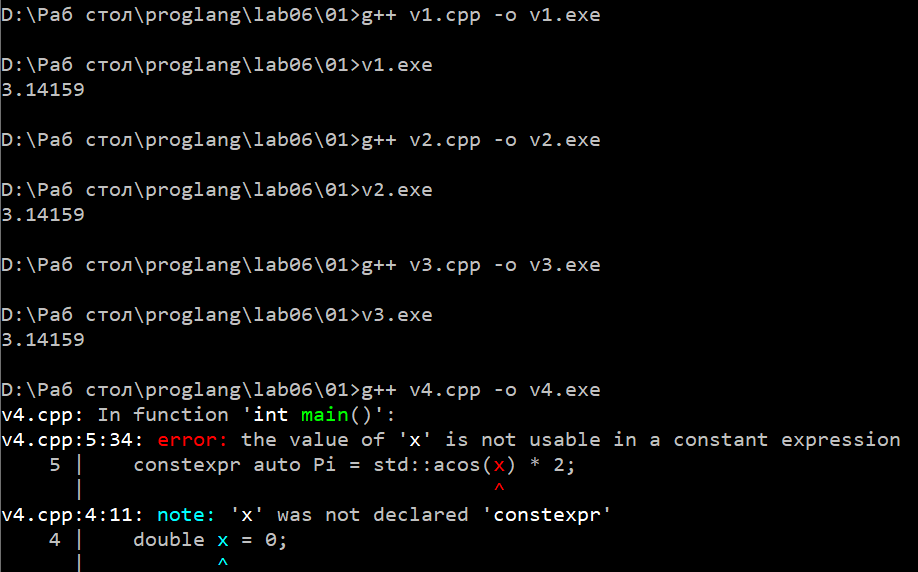

# Языки программирования
## Лабораторная работа 6

### Задание 1 **(3)**
*Рассмотрим следующую программу на С++.*

```
#include <iostream>
#include <cmath>
int main() {
   double x = 0;
   const auto Pi = std::acos(0) * 2;
   std::cout << Pi << std::endl;
   return 0;
}
```
*Проверьте четыре способа объявления* **Pi**.

* ```const auto Pi = acos(0) * 2;```

Файл откомпилировался. const без constexpr не требует вычисления на этапе компиляции. std::acos не является constexpr - функцией по стандарту, поэтому это не константное выражение.
Значение вычисляется во время выполнения. Не является константой этапа трансляции.

* ```constexpr auto Pi = std::acos(0) * 2;```

Откомпилировался успешно. constexpr требует, чтобы инициализатор был константным выражением. std::acos не помечена как constexpr в стандарте. Получается, что вычисление происходит на этапе компиляции как встроенной функции.
Не является константой этапа трансляции.

* ```const auto Pi = acos(x) * 2;```

Компиляция без ошибок. х - обычная переменная, ее значение не является константным выражением. Вычисление точно происходит при выполнении. Не является константой этапа трансляции.

* ```constexpr auto Pi = std::acos(x) * 2;```

При компиляуии произошла ошибка, потому что х не является константным выражением, поэтому его нельзя использовать в инициализаторе consrexpr-пременной. 
Кроме того, функция std::acos не объявлена как constexpr  в стандарте С++, поэтому ее вызов не является константым выражением. 



*Что можно сказать об этих вариантах? Проверьте, в каких вариантах объявляется константа этапа трасляции.*

*Тексты программ разместите в папке с номером задания*


### Задание 2 **(2)**
*Проверьте работу следующей программы на С++*

```
#include <iostream>

int main() {
   {
      int x, y;
      std::cin >> x >> y;
      std::cout << x+y << std::endl;
   }
   {
      double x, y;
      std::cin >> x >> y;
      std::cout << x+y << std::endl;
   }
   return 0;
}
```
*Нужны ли в этой программе вложенные фигурные скобки? Дайте подробный ответ с объяснением причин.*

Если убрать вложенные фигурные скобки, то код не откомпилируется, потому что обе пременные находятся в одной и той же области видимости тела main.
В С++ нельзя повторно объявить переменную с тем же именем в той же области видимости, даже если у нее другой тип.

Фигурные скобки создают вложенную область видимости. Правило C++: имя можно объявить заново во внутренней области видимости, и оно скроет одноимённое имя из внешней области. Во внутреннем блоке имя x из внешнего блока не видно — оно перекрыто.
Но здесь блоки не вложены друг в друга, а идут последовательно - это два соседних блока внутри main.

В данной программе смысл скобок к том, чтобы разнести одноименные переменные по разным областям видимости и тем самым избежать ошибки повторного объявления.

Скобки можно было бы убрать, если бы к имени перемнных добавили нумерацию (х1, х2), потому что для работы программы они не обязательны.


### Задание 3 **(2)**
*Проверьте работу следующего фрагмента программы на С++.*
```
int s = 0;
for (int i = 0; i < 4; i++) {
   for (int i = 0; i < 3; i++) {
      s += i;
   } 
   s += i; 
}
std::cout << s;
```
*В результате каких вычислений был получен ответ? Дайте подробный ответ.*

Внутренний i - это отдельная переменная, объявленная в заголовке внутреннего for. 
Её область видимости - тело внутреннего цикла. Внешний i при этом продолжает существовать, но внутри внутреннего цикла скрыт. 
Строка s += i; после внутреннего цикла относится уже к внешнему i.

Внешний цикл: i получает значения 0, 1, 2, 3.
Внутренний цикл при каждом фиксированном i полностью пробегает i = 0, 1, 2 и добавляет к s сумму 0+1+2 = 3.
Затем после внутреннего цикла добавляется текущее значение i.

Внутренний цикл при каждом занчении внешнего i добавляет 3, итого 12. 
Затем на внешнем цикле к s прибавляется значение внешнего i, то есть 1+2+3=6.
Получается, что резульатом будет 12+6=18.

Внутренняя i затеняет внешнюю только внутри тела внутреннего цикла

### Задание 4 **(2)**

*Проверьте работу следующего фрагмента программы на* **Python**.
```
s = 0
for i in range(4):
   for i in range(3):
      s += i
   s += i
print(s)
```
*В результате каких вычислений был получен ответ? Дайте подробный ответ.*

*На основе этих примеров поясните различия между* **С++** и **Python** *при работе с переменными*.

В отличие от C++, где внутренний int i - отдельная затеняющая переменная, в Python for лишь присваивает значение единственной переменной i (блочной области видимости нет). Внутренний цикл каждый раз добавляет 0+1+2 = 3 (всего 12), после чего i всегда равно 2, и строка s += i добавляет 2 четыре раза (всего 8). Итог 12 + 8 = 20.
В C++ аналогичная строка добавляла внешнюю i = 0,1,2,3 (сумма 6), давая 18.
Различие получается, потому что C++ требует объявления переменных и имеет блочную область видимости с возможностью затенения, а Python использует динамические имена без блочных областей видимости, где переменная цикла остаётся после его завершения.

Итого получается, что в резульате программы будет выведено 20.

### Задание 5 **(2)**

*Напишите свой пример программы на* **С++**, *создающий и использующий пространства имен. Программа
должна содержать не менее двух пространств имен.*

```

#include <iostream> 
int main() {
   {
      namespace first {
         int num=10;
         void show() {
            std::cout << "first: " << num << std::endl;
         }
      }
      first::show();
      std::cout << first::num << std::endl;
   }
   {
      namespace second {
         int num = 20;
         void show() {
            std::cout << "second: " << num << std::endl;
         }
      }
      second::show();
      std::cout << second::num << std::endl;
   }
   return 0;
}
```

### Задание 6 **(2)**

*Рассмотрим следующий фрагмент программы. Эта программа 1000000 раз обменивает значения двух длинных 
строк с использованием третьей строки. Проверьте, насколько быстро она работает.*

```
std::string a(100000, 'a');
std::string b(100000, 'b');
for (int i=0;i<1000000;i++) {
   std::string c(a);
   a = b;
   b = c;
}
std::cout << a[0] << b[0];
```
*Попробуйте использовать для обмена значений строк функцию* **swap**. 
*Проверьте, изменилось ли время работы. В чем ошибка исходной программы?
Исправьте исходную программу, чтобы ускорить ее работу. Изменения не должны 
затрагивать общий вид программы (присваивания, использование временной переменной).*


Исходная программа работет неэффективно, потому что в цикле выполняется копирование строк по 100 000 символов, а не обмен указателями. 
Функция swap решает эту проблему: она меняет внутренние указатели и размеры строк за строго отведенное время, без копирования самих данных.

Строка std::string c(a); создаёт полную копию строки a (100 000 байт). Затем a=b; копирует 100 000 байт из b в a. И b=c; копирует ещё 100 000 байт из c в b.
Получается, что за один проход 300 000 скопированных байт, что как раз и влияет на скорость работы программы. 

```
#include <iostream>
#include <string>
int main() {
    std::string a(100000, 'a');
    std::string b(100000, 'b');
    for (int i = 0; i < 1000000; i++) {
        std::swap(a, b);
    }
    std::cout << a[0] << b[0];
    return 0;
}
```
Здесь std::swap(a,b) для std::string эквивалентен a.swap(b) и работает за константное время. После цикла a содержит символы 'b', а b - 'a'. Вывод: ba.

Для ускорения работы исправленная программа будет выглядеть так:

```
#include <iostream>
#include <string>
#include <utility>

int main() {
    std::string a(100000, 'a');
    std::string b(100000, 'b');
    for (int i = 0; i < 1000000; i++) {
        std::string c(std::move(a));
        a = std::move(b);
        b = std::move(c);
    }
    std::cout << a[0] << b[0];
    return 0;
}
```

Получается:

	std::string c(std::move(a)) - перемещающий конструктор: c забирает буфер a, a остаётся пустой, без данных.
	a=std::move(b) - перемещающее присваивание: a забирает буфер b.
	b=std::move(c) - b забирает буфер c, в котором лежит исходное содержимое a.

### Задание 7 **(2)**

*Рассмотрим программу на языке* **Python**.
```
a = 'Hello world'
print(a, id(a))
b = a
print(b, id(b))
a += ' and goodbye'
print(a, id(a))
print(b, id(b))
```
*Объясните ее работу. В какой момент создавались строки? 
Что означает значение, возвращенное функцией* **id**?

1. a='Hello world'
Создаётся строковый объект 'Hello world'. Имя a - это ссылка на этот объект. Строки в Python неизменяемы.

2. print(a,id(a))
Печатается содержимое и id объекта. id() возвращает уникальный идентификатор объекта - в Python это фактически адрес объекта в памяти. Пока объект жив, id не меняется.

3. b=a
Имя b начинает ссылаться на тот же самый объект, что и a. В памяти по-прежнему одна строка 'Hello world', на неё две ссылки.

4. print(b,id(b))
b и a указывают на один объект - id(b)==id(a). Вывод одинаковый.

5. a+=' and goodbye'
+= для строки - это не изменение, а создание нового объекта: вычисляется a + ' and goodbye' - новый строковый объект 'Hello world and goodbye', и имя a перепривязывается к нему. Старый объект 'Hello world' остаётся в памяти, потому что на него всё ещё ссылается b.

6. print(a, id(a))
a теперь ссылается на новый объект - id(a) изменился.

7. print(b, id(b))
b по-прежнему ссылается на старый объект 'Hello world' - id(b) не изменился.

В итоге получается, что в памяти остается 2 строки.

### Задание 8 **(2)**

*Пусть* **a** - *строковая переменная в программе на* **Python**.
*Есть ли разница между работой присваивания*
```b = a```
и
```b = a[:]```
*Напишите программу для демонстрации различий.*

Для строк в Python разницы нет - обе конструкции дают b, ссылающийся на тот же самый объект, что и a.
Так получается, потому что строки неизменяемы, и a[:] (полный срез) для строки возвращает сам объект a, а не копию. 

```
a = 'Hello'
b = a
c = a[:]

print("b is a:", b is a)
print("c is a:", c is a)
print("id(b)==id(a):", id(b) == id(a))
print("id(c)==id(a):", id(c) == id(a))
```

Разница между может появляться для изменяемых типов, например для списка: для list x = lst даёт ссылку, а lst[:] - независимую копию.

###  Задание 9 **(3)**
*Напишите программу на языке* **Python**, *которая создаст 2600 переменных с именами
от* **a0** *до* **a99**, *от* **b0** *до* **b99** *и так далее, от* **z0** *до* **z99**. 
*Присвойте всем переменным различные значения от 1 до 2600.*

```
vars = {}
value = 1
for letter in 'abcdefghijklmnopqrstuvwxyz':
    for num in range(100):
        vars[f'{letter}{num}'] = value
        value += 1

print(len(vars))
print(vars['a0'], vars['a99'], vars['z0'], vars['z99'])
```

Программа создаёт пустой словарь vars и счётчик value=1.
Внешний цикл перебирает 26 букв 'a'…'z', внутренний - 100 чисел 0…99. 
На каждой из 2600 итераций f-строка f'{letter}{num}' формирует ключ ('a0', 'a1', …, 'z99'), по которому в словарь записывается текущее значение value, после чего value увеличивается на 1.
В результате получается словарь, который содержит 2600 пар