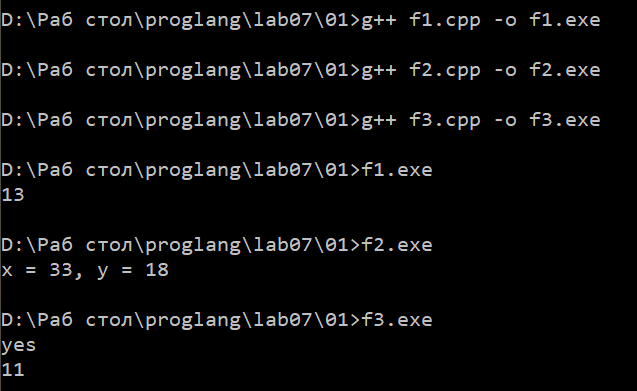
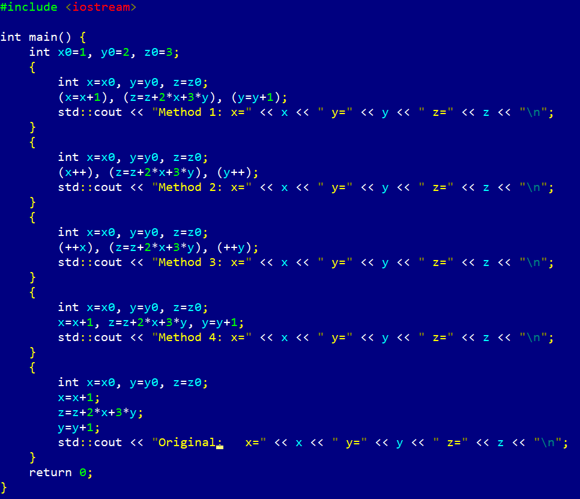
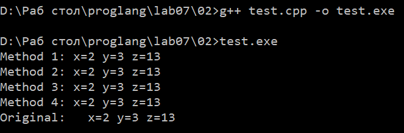
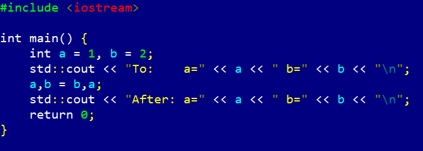
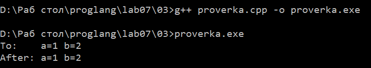
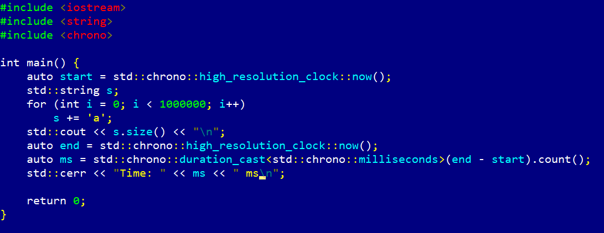
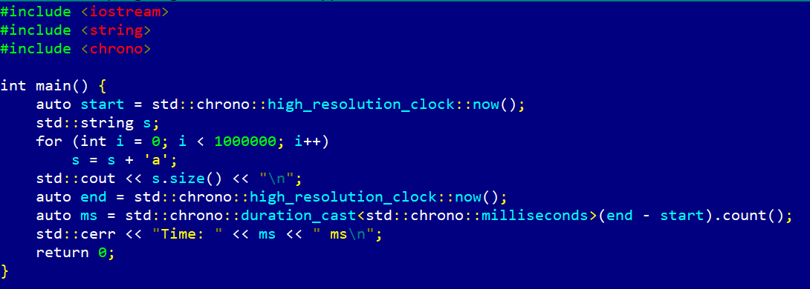
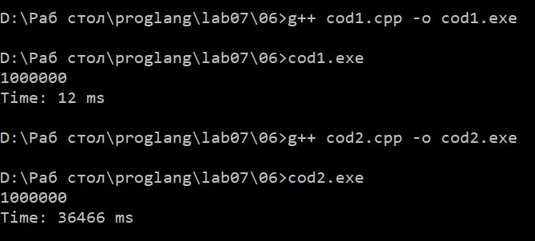
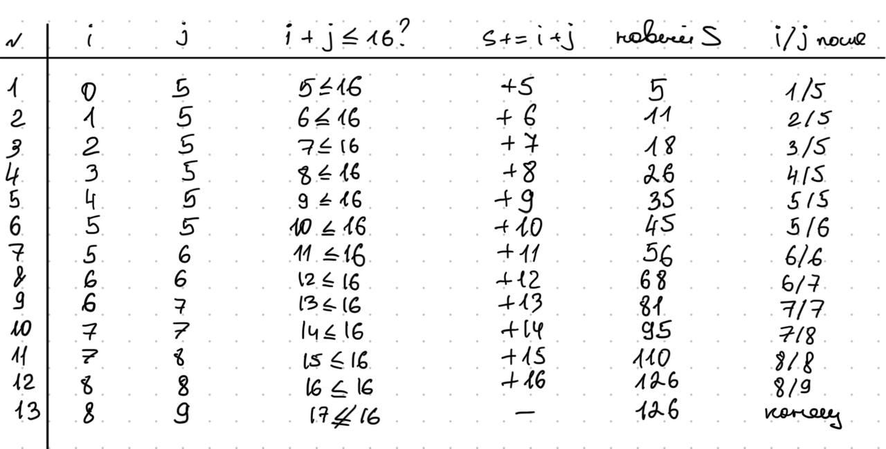
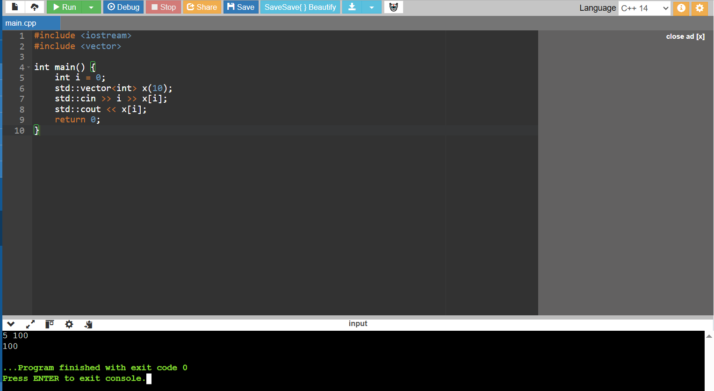

# Языки программирования
## Лабораторная работа 7

### Задание 1 **(2)**
*Оцените работу следующих фрагментов программ. Какие из них обладают неоднозначным поведением? Почему?*
```
int x=10, y=3;
std::cout << std::min(x=15, x+y);
```
В данном случае это неоднозначное поведение. Порядок вычисления аргументов функции не определён.
Один аргумент изменяет x, другой читает x, в C++ - неспецифицированный результат (может быть 15 или 18).
Получается, что нарушено правило: между изменением и чтением объекта должна быть точка следования.

```
int x=10, y=3;
x=15, y+=x, x+=y;
```
В этом фрагменте поведение определено.
Используется встроенный оператор запятая, который гарантирует строгий порядок слева направо:
 сначала x=15, затем y+=x (y=18), затем x+=y (x=33). Итог: x=33, y=18.
Получается, что неоднозначности нет.

```
int x=10, y=9;
if (x>y++ && y++>9)
  cout << "yes" << endl;
cout << y;
```
В данном фрагменте переменная y дважды инкрементируется в одном выражении.
В более новых версиях с++ оператор && гарантирует строгий порядок: сначала левая часть, затем правая — результат определён (yes, y=11).
Но в более старых не гарантировал, что побочный эффект первого y++ завершится до чтения y во втором y++.
Из-за этого модификация и чтение y могли пересекаться — получается это неопределённое поведение.


*Тексты программ разместите в папке с номером задания*



### Задание 2 **(2)**
*Как записать следующие строки программы на С++ в виде одного
выражения? Приведите несколько способов, в том числе с использованием операторов инкремента.*
*Проверьте работу написанных программ*
```
x=x+1;
z=z+2*x+3*y;
y=y+1;
```
*Тексты программ разместите в папке с номером задания*

Способ 1
```
(x = x + 1), (z = z + 2*x + 3*y), (y = y + 1);
```
Просто убираем точки с запятой и поставили запятые. Порядок сохраняется — оператор , вычисляет левый операнд полностью до правого.

Способ 2
```
(x++), (z = z + 2*x + 3*y), (y++);
```
x++ возвращает старое значение, но побочный эффект (увеличение x) завершается до начала следующего операнда запятой.
Поэтому в z = z + 2*x + 3*y уже используется новое x. Работает корректно.

Способ 3
```
(++x), (z = z + 2*x + 3*y), (++y);
```
++x сразу возвращает новое значение и применяет побочный эффект. То же самое по смыслу, что и способ 2, но запись чуть короче.

Способ 4
```
x = x + 1, z = z + 2*x + 3*y, y = y + 1;
```
Без скобок. Оператор , имеет самый низкий приоритет, поэтому вся строка — одно выражение, вычисляемое слева направо. Эквивалентно способу 1.






### Задание 3 **(2)**
*Рассмотрите следующий фрагмент программы. Он заполняет вектор из 10 элементов единицами.*
```
std::vector<int> x(10);
for (int i = 0; i < 10;)
   x[i++] = 1;
```
*Перепишите ее так, чтобы в третьей строке использовался префиксный инкремент, но результат ее работы не изменился.*
```
std::vector<int> x(10);
for (int i=0; i<10; ++i)
   x[i]=1;
```
int i=0 — счётчик с нуля (индексы 0…9).
 i<10 — условие: пока индекс меньше 10, тело выполняется. Гарантирует, что не выйдем за границу вектора.
 ++i — префиксный инкремент после каждой итерации (в заголовке, а не в теле).
 x[i]=1 — присваиваем текущему элементу единицу.

### Задание 4 **(2)**

*Почему присваивание* ```(++x)=y``` *является синтаксически правильным, а*
```(x++)=y``` - *нет? Запишите текст сообщения об ошибке, переведите и объясните его.*
Причина в том, что префиксный инкремент (++x) возвращает lvalue (левостороннее значение, то есть объект, который можно изменять), а постфиксный инкремент (x++) возвращает rvalue (правостороннее значение, то есть временную копию, которую нельзя присваивать).
 Оператор присваивания = требует, чтобы слева находился модифицируемый lvalue (то есть переменная, находящаяся в памяти).
 Поэтому (++x) = y допустимо, а (x++) = y — нет.

Текст ошибки: 

	error: lvalue required as left operand of assignment

Перевод: слева от оператора присваивания требуется lvalue (левостороннее значение)

Объяснение:
	
1) ++x: сначала увеличивает x на 1, затем возвращает ссылку на сам x (lvalue). Поскольку это ссылка на реальную переменную, ей можно присвоить значение, поэтому (++x) = y означает увеличить x на 1, затем присвоить y.

2) x++: сначала создаёт временную копию исходного значения x, затем увеличивает x на 1 и, наконец, возвращает эту временную копию (rvalue).
Временное значение существует только в момент вычисления выражения, у него нет постоянного адреса в памяти, поэтому ему нельзя присвоить значение, и компилятор выдаёт ошибку. 

### Задание 5 **(2)**

*Программисты на Python для обмена значений двух переменных часто пишут строку*
```
a,b = b,a
```
*Проверьте, будет ли аналогичная строка на С++ (с точкой с запятой в конце) являться синтаксически
правильной? Будет ли она обменивать значения переменных? Как в языке С++ вычисляется это выражение?*

 a,b = b,a; в C++ синтаксически корректно, но не обменивает значения переменных. В C++ нет множественного присваивания, как в Python.
Это выражение использует оператор запятая (,) и оператор присваивания (=), и порядок вычисления приводит к потере значения, а не к обмену.

Выражение на самом деле гурппируется так:  a, (b = b), a
Получается, что процесс вычислений следующий:

1) Вычисляется a (первый операнд оператора запятая). Значение a вычисляется, но результат отбрасывается.

2) Вычисляется b = b (из-за высокого приоритета =). Это присваивает b само себе, значение b не меняется. Результатом этого присваивания является значение b, но оно также отбрасывается.

3) Вычисляется a (последний операнд оператора запятая). Значение a вычисляется, но не присваивается никакой переменной.

4) Возвращается значение последнего выражения (то есть a), но поскольку за ним следует ;, это значение также отбрасывается.






### Задание 6 **(2)**

*Проверьте работу следующего фрагмента программы*
```
  std::string s;
  for (int i=0; i<1000000; i++)
     s += 'a';
  std::cout << s.size();
```
*Измените третью строку на*
```
s=s+'a';
```
*Изменится ли что-нибудь в ее работе? Объясните результат.*

Оператор += для std::string — это отдельная функция класса, которая модифицирует исходную строку на месте, добавляя символ в конец. 

Во втором случае задействован оператор +, который создаёт новую временную строку, содержащую результат конкатенации, а затем присваивает её обратно в s.

Получается, что результат работы программы не изменится (обе версии выведут 1000000), но производительность изменится кардинально. 
s += 'a' — правильный и эффективный способ; s = s + 'a' в цикле — антипаттерн, который на больших объёмах данных приводит к квадратичному замедлению.








### Задание 7 **(2)**

*Как работает следующая программа? Как зависит результат от исходного значения?*
```
int x;
std::cin >> x;
x-->0 && x-->0 && x-->0 && x-->0 && x-->0;
std::cout << x;
```
Работа программы:
1) Объявляем x. Значение не инициализировано (мусор), дальше перезапишем.

2) Считываем число с клавиатуры в x.

3) x-->0 — это не оператор, а (x--) > 0: сравниваем старое значение x с 0, потом уменьшаем x на 1.
Пять таких частей через &&. && вычисляет слева направо и останавливается при первом ложном — правые части тогда не выполняются, x дальше не уменьшается.
Каждая выполненная часть уменьшает x на 1

4) Печатаем итоговое x. 

Получается,каждая выполненная часть уменьшает x на 1. Сколько частей выполнится — зависит от того, на какой части сравнение с 0 впервые даст false

Общая формула
1) Если x <= 0: результат x - 1.

2) Если 1 <= x <= 4: результат -1 (цикл останавливается, когда x доходит до 0, и последний декремент делает его -1).

3) Если x >= 5: результат x - 5 (все пять частей выполнились).

### Задание 8 **(3)**

*Какое число выводит следующий фрагмент программы? Посчитайте результат без использования
вычислительной техники. Отчет должен содержать процесс вычислений.*
```
int s = 0;
for (int i = 0, j = 5;i+j <= 16;(i<j ? i : j)++)
   (s += i) += j;
std::cout << s;
```
Инкримент в заголовке увеличивает на 1 ту переменную, которая меньше. Постфиксный, но результат не используется, важен только побочный эффект.

В теле цикла, сначала s увеличивается на i, затем к тому же s прибавляется j

Условие i+j<=16 выполняется перед каждой итерацией.



Ответ 126

###  Задание 9 **(3)**
*Рассмотрите следующую программу. Предполагается, что на вход подается некоторый
индекс в массиве - число от нуля до девяти и значение, которое надо записать по этому индексу.*
```
int i = 0;
std::vector<int> x(10);
std::cin >> i >> x[i];
std::cout << x[i];
```
*Проверьте работу этой программы на различных компиляторах. Найдите два компилятора (можно 
проверить онлайн компиляторы), на которых эта программа будет давать различные ответы при одинаковом
вводе. Как это объяснить?*

Выражение std::cin >> i >> x[i] в конечном итоге преобразуется в цепочку вызовов функций

Вложенный operator>>(std::cin, i) изменяет переменную i, а внешний x[i] читает переменную i для индексации.
Стандарт C++ (до C++17) не определяет порядок вычисления аргументов функций — компилятор может сначала вычислить operator>>(std::cin, i), а затем x[i], или наоборот.
Если сначала вычисляется x[i], то i в этот момент всё ещё имеет исходное значение (например, 0, если ввод не удался, или значение, оставшееся от предыдущей операции), и cin запишет введённое значение в x[0]; если сначала вычисляется внутренний operator>>, то i уже обновлено до введённого пользователем значения, и cin запишет в x[введённое_значение]. 
Эти два порядка дают совершенно разные результаты, и стандарт не требует, чтобы компилятор придерживался одного из них, поэтому это неопределённое поведение.


